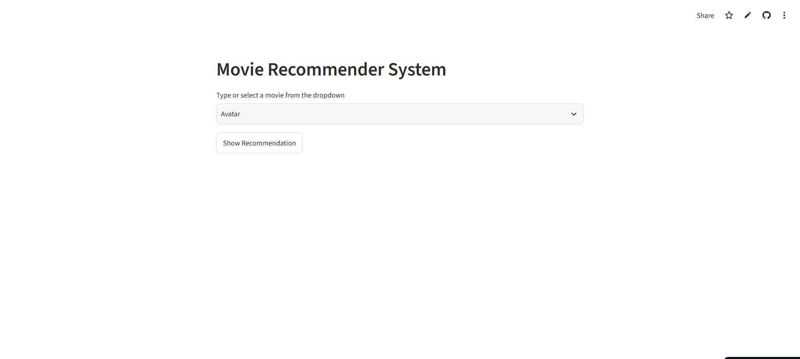
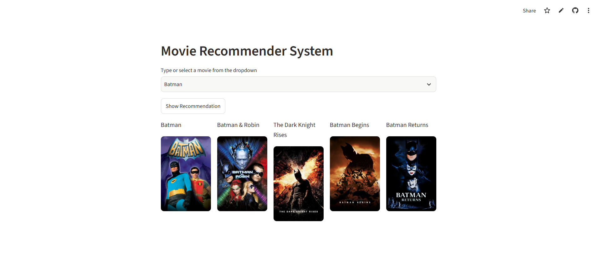

# 🎬 Movie Recommender System

A content-based movie recommendation system built using **Python, Machine Learning and Streamlit**. The application recommends five movies similar to a movie selected by the user, using movie metadata, CountVectorizer and cosine similarity.

<p align="center">
  <a href="https://movie-recommender-system-nhx9ffc7wtdk5sswogxabq.streamlit.app/">
    <strong>🚀 Live Demo – Try the Movie Recommender System</strong>
  </a>
</p>

---

## 📸 Application Preview

### Home Page



### Movie Recommendations



---

## 📌 Project Overview

The Movie Recommender System is a content-based filtering application that suggests movies based on similarities in their content and metadata.

Unlike collaborative filtering systems, which rely on user ratings or preferences from multiple users, this project analyzes movie information such as:

- Movie overview
- Genres
- Keywords
- Main cast members
- Directors

These features are combined into a single textual representation for each movie. Machine learning techniques are then used to identify movies with similar content.

The application allows users to select a movie from a dropdown and receive five similar movie recommendations, along with their posters fetched using The Movie Database (TMDB) API.

## ✨ Key Features

- **Content-Based Recommendations:** Suggests movies based on metadata similarity.
- **Movie Selection:** Search and select a movie from the available movie collection.
- **Top 5 Recommendations:** Displays five movies most similar to the selected movie.
- **Movie Posters:** Fetches movie posters dynamically using the TMDB API.
- **Interactive Interface:** Built using Streamlit.
- **Precomputed Similarity:** Loads serialized movie data and similarity scores for efficient recommendation retrieval.
- **Live Deployment:** Hosted on Streamlit Community Cloud.

## 🛠️ Tech Stack

| Technology | Purpose |
|---|---|
| Python | Core programming language |
| Pandas | Data manipulation and preprocessing |
| NumPy | Numerical operations |
| Scikit-learn | Text vectorization and cosine similarity |
| CountVectorizer | Converts movie descriptions into numerical feature vectors |
| Streamlit | Interactive web application |
| Pickle | Serialization of processed movie data and similarity matrix |
| Requests | HTTP requests to the TMDB API |
| TMDB API | Fetching movie posters |
| Git & GitHub | Version control and project hosting |

## 📂 Dataset

This project uses the **TMDB 5000 Movie Dataset**, consisting of two files:

1. `tmdb_5000_movies.csv` – Contains movie information such as titles, overviews, genres, keywords and other metadata.
2. `tmdb_5000_credits.csv` – Contains cast and crew information for movies.

The two datasets are merged using the movie title to combine movie details with cast and crew information.

The merged dataset contains approximately 4,800 movie records.

## ⚙️ Implementation Details

The project is implemented in two major stages:

1. Machine Learning Model Development
2. Streamlit Application Development

### 1. Data Loading and Preprocessing

The movie and credits datasets are loaded using Pandas and merged using the common `title` column.

Only the following features are retained for recommendation:

- `movie_id`
- `title`
- `overview`
- `genres`
- `keywords`
- `cast`
- `crew`

Missing values are removed to ensure consistent processing.

### 2. Feature Extraction

The structured metadata is converted into meaningful textual features.

The preprocessing pipeline includes:

- Extracting genre names from JSON-like strings.
- Extracting keyword names.
- Extracting the first three cast members.
- Extracting director names from crew information.
- Removing spaces within names to preserve multi-word entities as single tokens.
- Splitting movie overviews into individual words.

All these features are combined into a single column called `tags`.

For example, a movie's tags combine its overview, genres, keywords, actors and director into one textual representation.

### 3. Text Vectorization Using CountVectorizer

The combined movie tags are converted into numerical feature vectors using Scikit-learn's `CountVectorizer`.

Configuration:

```python
CountVectorizer(
    max_features=5000,
    stop_words='english'
)
```

- `max_features=5000` limits the vocabulary to the 5,000 most relevant terms.
- `stop_words='english'` removes common English words that provide little useful information.

The resulting feature matrix represents each movie as a numerical vector.

### 4. Similarity Calculation Using Cosine Similarity

Cosine similarity is used to measure the similarity between movie feature vectors.

```python
from sklearn.metrics.pairwise import cosine_similarity

similarity = cosine_similarity(vector)
```

Cosine similarity measures the cosine of the angle between two vectors.

Its value generally ranges from 0 to 1 for these non-negative feature vectors:

- A value closer to 1 indicates greater similarity.
- A value closer to 0 indicates lower similarity.

The resulting similarity matrix stores pairwise similarity scores between movies.

### 5. Model Serialization

To avoid repeating the preprocessing and similarity calculations whenever the application starts, the processed movie data and similarity matrix are saved using Pickle.

```python
pickle.dump(new, open('movie_list.pkl', 'wb'))
pickle.dump(similarity, open('similarity.pkl', 'wb'))
```

The two serialized files are:

- `movie_list.pkl`
- `similarity.pkl`

These files are loaded directly by the Streamlit application.

### 6. Recommendation Logic

When a user selects a movie:

1. The selected movie's index is identified in the movie DataFrame.
2. Its corresponding row is retrieved from the similarity matrix.
3. Movies are sorted in descending order of similarity scores.
4. The selected movie itself is excluded.
5. The next five most similar movies are returned.

The recommendation logic uses the following approach:

```python
index = movies[movies['title'] == movie].index[0]

distances = sorted(
    list(enumerate(similarity[index])),
    reverse=True,
    key=lambda x: x[1]
)

for i in distances[1:6]:
    print(movies.iloc[i[0]].title)
```

This produces the five highest-ranked recommendations based on content similarity.

## 🏗️ Application Architecture

The overall workflow can be represented as:

```text
TMDB Movies Dataset + Credits Dataset
                 |
                 v
          Data Preprocessing
                 |
                 v
       Feature Extraction and Tags
                 |
                 v
          CountVectorizer
                 |
                 v
       Cosine Similarity Matrix
                 |
                 v
       Pickle Model Serialization
                 |
                 v
          Streamlit Application
                 |
                 v
          User Selects Movie
                 |
                 v
       Top 5 Similar Movie Results
                 |
                 v
          TMDB Poster API
                 |
                 v
       Display Movies and Posters
```

## 📁 Project Structure

```text
Movie-Recommender-System/
│
├── .streamlit/
│   └── secrets.toml          # Local API key configuration (not committed)
│
├── assets/
│   ├── app_home.png
│   └── recommendations.png
│
├── model/
│   ├── movie_list.pkl
│   └── similarity.pkl
│
├── notebooks/
│   └── movie-recommender-system.ipynb
│
├── main.py                   # Streamlit application
├── requirements.txt          # Application dependencies
├── .gitignore
└── README.md
```

## 🚀 Run Locally

### 1. Clone the Repository

```bash
git clone https://github.com/ojas1888/Movie-Recommender-System.git
cd Movie-Recommender-System
```

### 2. Create a Virtual Environment

```bash
python -m venv .venv
```

Activate it:

**Windows:**

```powershell
.venv\Scripts\activate
```

**Linux/macOS:**

```bash
source .venv/bin/activate
```

### 3. Install Dependencies

```bash
pip install -r requirements.txt
```

### 4. Configure the TMDB API Key

Create a `.streamlit/secrets.toml` file:

```toml
TMDB_API_KEY = "YOUR_TMDB_API_KEY"
```

Replace the placeholder with your own TMDB API key.

Never commit this file or expose your API key publicly.

### 5. Run the Application

```bash
streamlit run main.py
```

The application will open in your browser.

## 🌐 Deployment

The application is deployed using **Streamlit Community Cloud** and connected to the GitHub repository.

The TMDB API key is configured securely through Streamlit's application secrets.

**Live Application:** [Movie Recommender System](https://movie-recommender-system-nhx9ffc7wtdk5sswogxabq.streamlit.app/)

**GitHub Repository:** [Movie-Recommender-System](https://github.com/ojas1888/Movie-Recommender-System)

## 🔮 Future Improvements

Potential enhancements include:

- Adding genre-based and popularity-based filtering.
- Displaying additional movie information such as ratings, release dates and descriptions.
- Improving recommendation quality using TF-IDF and alternative similarity techniques.
- Adding user authentication and personalized watchlists.
- Optimizing similarity storage and retrieval for larger datasets.

## 🙌 Acknowledgements

- [TMDB](https://www.themoviedb.org/) for movie metadata and poster images.
- [Scikit-learn](https://scikit-learn.org/) for machine learning utilities.
- [Streamlit](https://streamlit.io/) for the application framework.
- The creators of the TMDB 5000 Movie Dataset.

---

<p align="center">
  If you find this project interesting, consider giving the repository a ⭐
</p>
